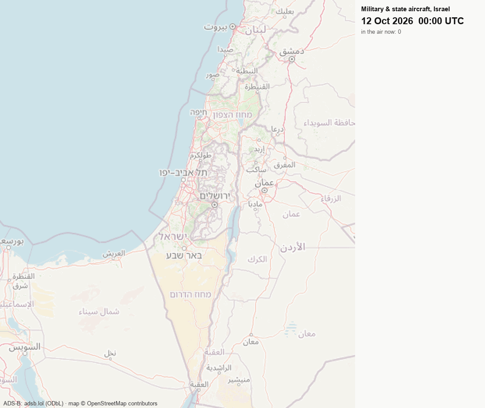
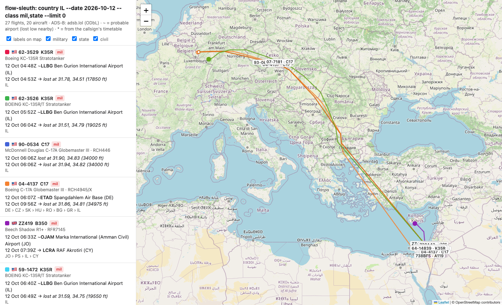
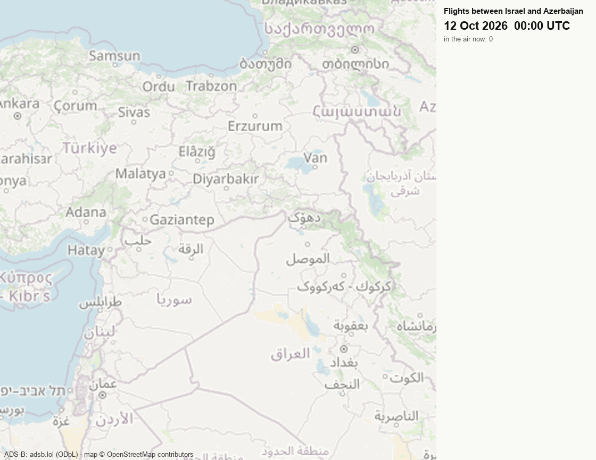
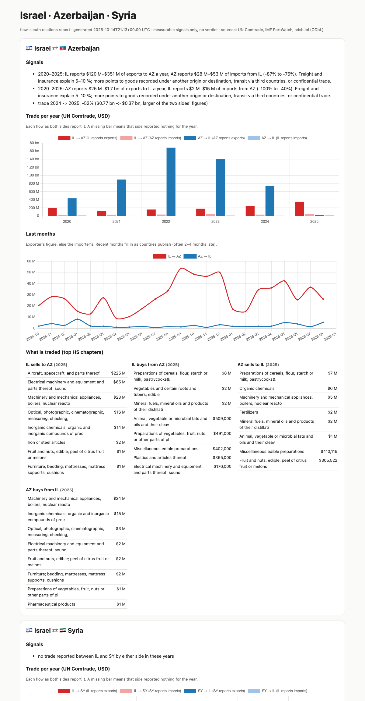
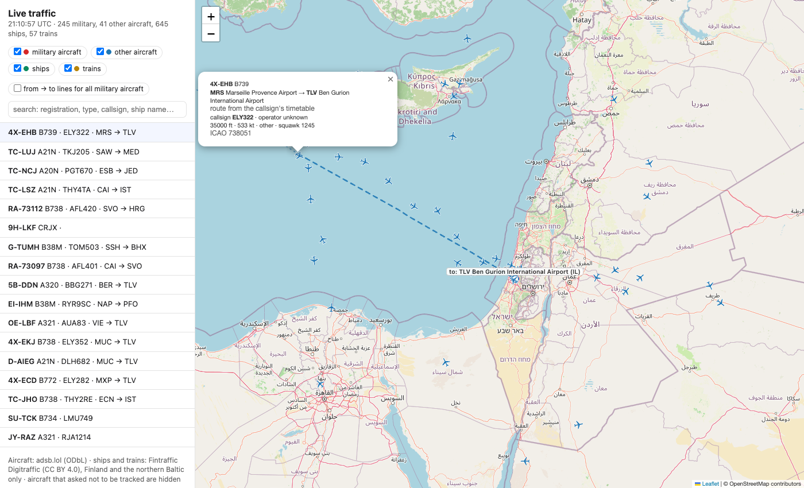

# flow-sleuth

**What moves between countries: aircraft, ships, trains and trade, from open data, with no API keys.**

Pick one or more countries and a period, and flow-sleuth answers questions like these:

- Which military, state and civil aircraft landed in a country, took off from it or flew over it?
- Where did those aircraft come from and where did they go?
- Which aircraft type was it, and what was its registration, callsign and operator?
- How much do the countries trade, and do their own figures agree?
- How busy are their ports?
- What is moving right now?

It runs as command-line scripts, or as a [Claude Code](https://claude.com/claude-code) skill that you ask in plain language.

**[Project page with a live map and interactive examples →](https://mstkyvz.github.io/flow-sleuth/)**

<p align="center"></p>

*12 October 2026, military and state aircraft over Israel, replayed in 20-minute steps:*
- *US Air Force KC-135 tankers flying circuits out of Ben Gurion.*
- *C-17 transports arriving from US bases in Germany.*
- *An RAF A400M, and an RAF Shadow R1 flying Amman → RAF Akrotiri.*
- *Israeli Air Force Gulfstream and C-130J aircraft.*
- *Military hospital helicopters.*

---

## Contents

1. [Ask it a question](#ask-it-a-question)
2. [One country, one day](#1-one-country-one-day)
3. [Routes between countries, with stops](#2-routes-between-countries-with-stops)
4. [Relations report: trade, shipping, flights](#3-relations-report-trade-shipping-flights)
5. [Live map](#4-live-map)
6. [One aircraft over several days](#5-one-aircraft-over-several-days)
7. [How well a country is covered](#6-how-well-a-country-is-covered)
8. [How it works](#how-it-works)
9. [What it cannot tell you](#what-it-cannot-tell-you)
10. [Install](#install), [data and licences](#data-and-licences)

## Ask it a question

With the skill installed, ask in any language:

> Which military aircraft landed in Israel yesterday, and where did they come from?
>
> Did any aircraft fly from Israel to Azerbaijan last week, and over which countries?
>
> Compare trade between Azerbaijan and Israel as each side reports it.
>
> Is there anything flying over Syria right now?

The skill (`skills/flow-sleuth/SKILL.md`) turns the question into the commands below and runs them. It answers with:
- a table of times, aircraft, routes and airports;
- an interactive map;
- the limits that apply, such as receiver coverage, dark flights and late trade data.

## 1. One country, one day

```bash
uv run skills/flow-sleuth/scripts/day.py 2026-10-12        # download and index the day once (~6 min, ~190 MB kept)
uv run skills/flow-sleuth/scripts/query.py country IL --date 2026-10-12 --class mil,state --map out/il.html
```

```
legs touching IL: 27  (aircraft: 20)
  landed in IL: 9   took off in IL: 10   overflew / ends unknown: 12
by state of registry: {'US': 18, 'IL': 6, 'GB': 2, 'JO': 1}
landings in IL by airport:
     5  ~LLBG  Ben Gurion International Airport
     2  LLIC  Sourasky (Ichilov) Medical Center
     1  IL-0011  Kedma Airport
2026-10-12 06:07Z [mil] US 04-4137 C17 RCH4945/X  ~ETAD Spangdahlem Air Base (DE) -> first/last seen 31.86,34.81 at 34975 ft  via DE-CZ-SK-HU-RO-BG-GR-IL
2026-10-12 06:33Z [mil] GB ZZ419 B350 RFR7145     ~OJAM Marka International (Amman C (JO) -> LCRA RAF Akrotiri (CY)  via JO-PS-IL-CY
2026-10-12 09:01Z [mil] IL 667 C30J BENY          ~LLBG Ben Gurion International Air (IL) -> ~LLBG Ben Gurion International Air (IL)  via IL
```

Each line shows:
- the time (UTC);
- the class: `mil`, `state` or `civil`;
- the state of registry, taken from the aircraft's ICAO address;
- the registration, ICAO type code and callsign;
- the take-off and landing airports;
- the countries crossed, in order.

`--map` writes an interactive page. Every flight is listed with:
- the full aircraft type name, for example *Boeing C-17A Globemaster III*;
- the operator;
- from → to, and the countries crossed.

Each aircraft has its own colour and a label on its route. Click a flight to highlight it and zoom to it; its popup
also shows a photo of that aircraft from planespotters.net, when one exists, with the photographer's credit.

<p align="center"></p>

Other filters:
- `--class civil`, or no filter at all, for everything;
- `--reg-cc US`, for one state of registry;
- `--end 2026-10-14`, for a range of days.

## 2. Routes between countries, with stops

```bash
uv run skills/flow-sleuth/scripts/query.py route --from IL --to AZ --date 2026-10-12
uv run skills/flow-sleuth/scripts/query.py route --reg-cc AZ --via GE --date 2026-10-12      # Azerbaijani-registered aircraft over Georgia
uv run skills/flow-sleuth/scripts/query.py route --from DE --to IL --class mil --loose --date 2026-10-12
```

```
# itineraries from=IL via=* to=AZ: 5
4X-EMF E195 AIZ321  [civil] registry IL
   2026-10-12 03:06Z LLBG Ben Gurion International Airport (IL)
   2026-10-12 05:22Z  -> *UBBB Heydar Aliyev International (AZ)
HA-LDE A21N WZZ5618  [civil] registry HU
   2026-10-12 16:07Z LLBG Ben Gurion International Airport (IL)
   2026-10-12 19:10Z  -> LHBP Budapest Liszt Ferenc International (HU)
   2026-10-12 20:23Z LHBP Budapest Liszt Ferenc International (HU)
   2026-10-12 21:39Z  -> *UBBB Heydar Aliyev International (AZ)
…
```

How trips are matched:
- **Stops.** Legs of the same aircraft are joined into one trip when it takes off again from where it landed, within 18 hours. So `--from A --via B --to C` also finds "A → stop in B → C". One stop is allowed by default; change it with `--max-stops`.
- **From and to.** `--from` and `--to` are the countries of the take-off and landing airports. A track that is only lost over a country does not count as landing there.
- **`--loose`.** Uses the first and last country crossed when an airport was not heard. The C-17s from Spangdahlem (Germany) to Israel above need it, because their landings at Israeli bases were not received.

<p align="center"></p>

*All direct flights between Israel and Azerbaijan on 12 October 2026: four each way, flown by Azerbaijan Airlines,
Arkia and Israir. Azerbaijan Airlines' aircraft are registered in Bermuda (VP-B…), so their state of registry is BM.
Avoiding Syrian, Iraqi and Iranian airspace, they fly north over Cyprus and then east.*

## 3. Relations report: trade, shipping, flights

```bash
uv run skills/flow-sleuth/scripts/relations.py IL AZ SY --flights 2026-10-12:2026-10-12 --out out/il-az-sy
```

The command writes one page with a section for every pair of countries. Each section contains:

| Section | What it shows |
|---|---|
| **Signals** | Measurable changes and gaps. Trade up or down; years in which one side reported nothing while the other did; large mismatches between what one side says it exported and what the other says it imported. |
| **Trade per year** | All four flows (A's exports and imports, B's exports and imports), as each side reports them to UN Comtrade. |
| **Last 24 months** | Monthly trade each way. |
| **What is traded** | The top HS product chapters in each direction. |
| **Shipping** | Monthly port calls and seaborne tonnage, the busiest ports over the last 30 days, and IMF's modelled trade between each port and the other country. |
| **Flights** | Flights between the countries; military and state aircraft of one country seen in the other; overflights. |

Example of what the signals show for Israel and Azerbaijan:

```
2020–2025: AZ reports $25 M–$1.7 bn of exports to IL a year, IL reports $2 M–$15 M of imports from AZ (-100% to -40%).
2020–2025: IL reports $120 M–$351 M of exports to AZ a year, AZ reports $28 M–$53 M of imports from IL (-87% to -75%).
trade 2024 -> 2025: -52% ($0.77 bn -> $0.37 bn)
```

Each country's figures differ from the other's by far more than freight and insurance would explain. This happens
when goods are recorded under another origin, travel through third countries, or are traded confidentially. In 2025,
Israel's largest export chapter to Azerbaijan was *aircraft, spacecraft and parts* ($225 M).

For Syria, every flow comes only from the partner's side, because Syria does not report.

<p align="center"></p>

The page reports signals, not verdicts. It does not say whether relations are good or bad.

## 4. Live map

```bash
uv run skills/flow-sleuth/scripts/live.py --at 32.5,34.9        # all aircraft within 250 NM of this point, plus military worldwide
```

What the live map shows:
- **Aircraft.** Heading, registration, type, callsign, altitude and speed. Military aircraft are red. Clicking an aircraft also shows a small photo of it when [planespotters.net](https://www.planespotters.net) has one, with the photographer's credit and a link. The photo is loaded from planespotters.net, not copied.
- **Selected aircraft.** Click one to see where it took off and where it is going. The airports are labelled. A solid line shows the track flown since take-off. A dashed line shows the rest of the way to the destination, from the callsign's timetable.
- **All military routes.** One switch draws from → to lines for every military aircraft at once.
- **Ships and trains.** Shown where open live feeds exist: Finland and the northern Baltic.
- **Search.** By registration, type, callsign or ship name. The list puts what is in view first.

<p align="center"></p>

`live.py --snapshot out/live.json` writes one snapshot instead, for a static site.

## 5. One aircraft over several days

```bash
uv run skills/flow-sleuth/scripts/day.py 2026-10-10 2026-10-12
uv run skills/flow-sleuth/scripts/query.py aircraft 4X-EMF --date 2026-10-10 --end 2026-10-12 --map out/4x-emf.html
```

This works with a registration or an ICAO hex address. Every leg is listed with its airports, callsign and the
countries crossed.

## 6. How well a country is covered

Not seeing a flight only means something where receivers would have heard it. Check before reading an absence as
"nothing flew":

```bash
uv run skills/flow-sleuth/scripts/query.py coverage --date 2026-10-12 --cc IL,SY,AZ,IR,CN
```

```
cc  country       aircraft  low ends  landing seen
CN  China             4410      1923          18 %
IL  Israel             318       349          97 %
SY  Syria              399        10           0 %
IR  Iran                41        14          71 %
AZ  Azerbaijan         171         0             -
```

The columns:
- **aircraft**: how many aircraft were seen over the country.
- **low ends**: flights that ended low inside the country.
- **landing seen**: the share of those whose landing was heard at an airport.

Many aircraft but few landings seen means receivers hear overflights at altitude but not traffic near the ground,
as in Syria and China.

## How it works

| Step | What happens |
|---|---|
| Download | `day.py` streams one UTC day of [adsb.lol](https://adsb.lol) history (~4 GB): the full track of every aircraft its volunteer receivers heard. It keeps a compact copy, one record per flight leg. |
| Legs | A track is split where the aircraft landed (readsb's leg flag), or at gaps over 2 hours. |
| Airports | A leg that starts or ends on the ground, or within 2,500 ft of an airport's elevation and 6 km of it, gets that airport ([OurAirports](https://ourairports.com)). |
| Missing ends | Some ends are not heard. If the track was lost below 12,000 ft within 40 km of a large or medium airport, that airport is marked probable (`~`). Otherwise the callsign's timetable route is used, if the track runs along it (`*`, [VRS standing data](https://github.com/vradarserver/standing-data)). |
| Who | Registration, type and operator come from the readsb aircraft database. The state of registry comes from the ICAO 24-bit address block. |
| Class | `mil` if the database flags the aircraft as military. `state` if the operator name is governmental (government, royal, air force, police…). |
| Countries | The countries crossed are worked out from the track and [Natural Earth](https://www.naturalearthdata.com) land borders. |
| Trade | [UN Comtrade](https://comtradeplus.un.org) public API. One request per period covers all the countries, and responses are cached. |
| Ships | [IMF PortWatch](https://portwatch.imf.org): port calls and tonnage measured from AIS, plus IMF's modelled port-to-country trade. |
| Live | The adsb.lol live API, plus [Fintraffic Digitraffic](https://www.digitraffic.fi/en/) ships (AIS) and trains, both CC BY 4.0. |

## What it cannot tell you

- **Who was on board.** The data describes aircraft, never passengers. A flight from A to B says nothing about who flew on it.
- **Dark flights.** Many military aircraft switch ADS-B off or are missing from the database. Not seeing a flight does not mean it did not happen.
- **Poorly covered places.** Receivers are run by volunteers. Coverage is good over Europe, Israel and the US. It is weak or missing near the ground in Syria, Iraq, Azerbaijan and much of China. Run `coverage` first.
- **Airspace.** Countries crossed come from land borders, not from flight information regions or territorial waters.
- **Timetable routes.** A route marked `*` is what the callsign is scheduled to fly, not proof of where the aircraft went.
- **Trade data.** Figures are what governments report. Recent months arrive 2–4 months late, and some countries withhold figures for some partners or do not report at all. Both sides are shown rather than one being chosen.
- **Ships and trains.** Open live feeds exist only in some countries. Vessel positions elsewhere need an account (AISStream, Global Fishing Watch) and are not used.

## Privacy

Some aircraft owners have asked not to be tracked, under the FAA's PIA and LADD programmes, and the database flags
those aircraft. They are dropped when the data is downloaded and never shown. The tool is for state, military and
commercial movements, not for following private individuals.

## Install

You need [uv](https://docs.astral.sh/uv/). Each script declares its own dependencies. No keys are needed.

```bash
git clone https://github.com/mstkyvz/flow-sleuth && cd flow-sleuth
uv run skills/flow-sleuth/scripts/day.py 2026-10-12
```

To use it as a Claude Code skill, copy or link `skills/flow-sleuth` into `~/.claude/skills/`.

Tests run offline, with no network:

```bash
uv run skills/flow-sleuth/tests/test_core.py
```

The project page in `docs/` is published by `.github/workflows/pages.yml`. On every push, and every 15 minutes, it
runs the tests (on pushes), takes a new live snapshot and deploys the page.

To make the GIFs:

```bash
uv run docs/make_replay_gif.py country IL --date 2026-10-12 --class mil,state docs/img/il.gif --zoom 7 --bbox 29.3,32.2,34.2,37.2
uv run docs/make_replay_gif.py between IL,AZ --date 2026-10-12 docs/img/il_az.gif
```

## Data and licences

| Data | Licence |
|---|---|
| ADS-B history and live: adsb.lol | ODbL 1.0 |
| Aircraft database: readsb / tar1090-db (in the adsb.lol data) | ODbL |
| Airports: OurAirports | Public domain |
| Callsign routes: VRS standing data | CC0 |
| Country borders: Natural Earth | Public domain |
| ICAO address blocks: ICAO Annex 10 Vol. III | (facts) |
| Trade: UN Comtrade | UN terms of use |
| Ports: IMF PortWatch | IMF terms of use |
| Live ships and trains: Fintraffic Digitraffic | CC BY 4.0 |
| Map tiles: OpenStreetMap | ODbL |
| Aircraft photos: planespotters.net public photo API (shown from their servers with credit and link) | © the photographers |

Code: MIT.
